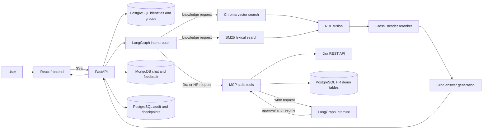

# Enterprise Knowledge Assistant

An enterprise-oriented assistant with a React frontend, FastAPI backend, and a
LangGraph workflow that routes knowledge questions to permission-filtered RAG
and Jira/HR requests to MCP tools. Write actions pause for explicit approval
before execution. MongoDB stores conversation history and feedback; PostgreSQL
stores identities, repository ACLs, approval state, HR demo data, checkpoints,
and query audit records.

## What is implemented

- **Intent router and RAG subgraph:** a Groq chat model returns a structured
  intent decision. Knowledge questions enter a compiled LangGraph RAG
  subgraph for retrieval, reranking, and answer generation; Jira and HR
  requests use the appropriate MCP tool.
- **Hybrid retrieval:** ChromaDB dense search and BM25 lexical search each
  return candidates. Reciprocal Rank Fusion (RRF) merges them, then a
  Sentence Transformers CrossEncoder reranks the fused results.
- **Document ingestion:** Markdown headers are split into sections; ordinary
  text uses recursive character chunks; Markdown tables are extracted into
  separate chunks with their headers repeated.
- **Group and repository ACLs:** user groups are loaded from PostgreSQL.
  Chroma metadata filters and BM25 pre-filtering apply the document-group ACL.
  Repository documents must also pass the PostgreSQL `repo_access` grants.
- **MCP actions:** the backend starts its included stdio MCP server and
  discovers/calls Jira issue lookup/create and HR leave-balance/request tools.
  Jira uses the Jira Cloud REST API. HR demo data and leave requests use
  PostgreSQL.
- **Human-in-the-loop writes:** Jira issue creation and HR leave submission
  pause using a LangGraph interrupt. The approval is checkpointed in
  PostgreSQL and recorded in a pending-action table. Resume verifies the
  requesting user, thread, expiry, and action arguments before executing.
- **Persistence and observability:** MongoDB stores per-user chat messages and
  feedback. PostgreSQL records query, source document IDs, answer hash,
  latency, action intent, and outcome.
- **Deployment assets:** Docker Compose starts PostgreSQL, MongoDB, backend,
  and frontend. Terraform describes an AWS ECS Fargate deployment with
  private application subnets, CloudFront, AWS WAF, and Secrets Manager
  integration.

## Architecture and request flow



For a knowledge request, the router dispatches into the compiled RAG subgraph.
ChromaDB searches with metadata filters; BM25 searches only the authorized
in-memory chunks. The lists are fused by
`score(document) = sum(1 / (60 + zero_based_rank))` and the CrossEncoder
returns the top five passages. The generation prompt uses those passages and
recent conversation history, asks for `[doc_id]` citations, and treats
retrieved content as untrusted input. If no authorized documents are found,
the backend returns a no-results response without calling the answer model.

For an action request, the router extracts known fields and the MCP host calls
the corresponding tool. Jira lookup and leave-balance lookup are read-only.
Issue creation and leave submission interrupt before the MCP write tool is
called. The frontend receives the proposed arguments over SSE, lets the user
review/edit them, then posts an approval or rejection to the resume endpoint.
An approved resume revalidates the arguments server-side.
Expired actions cannot be approved; they can be dismissed to clear the
suspended graph state. The API rejects another message on a thread while an
approval is unresolved, preventing a new request from replacing that
thread's checkpoint.

### Retrieval and ACL details

Each Markdown source document has YAML front matter containing `doc_id`,
`title`, and `allowed_groups`; repository documents also require a `repo`
slug. Ingestion stores the allowed groups in Chroma metadata both as a
comma-separated value and as boolean `grp_<name>` fields for vector filtering.
The valid group names are defined in `backend/app/config.py`.

The backend obtains user groups from the PostgreSQL `users` table. Repository
access is the intersection of (1) the user's groups, (2) the document's
`allowed_groups`, and (3) the repository's rows in `repo_access`. On first
startup only, if `repo_access` is empty, the backend seeds it from the
repository metadata in the current Chroma index. After that, manage grants in
PostgreSQL; the index is not authoritative for later ACL changes. An optional
`repo` in a chat request narrows the search further.

These filters are enforced in the vector query and before BM25 ranking. They
are application-layer authorization controls, not a substitute for verified
identity. The API currently accepts a caller-supplied `user_id`; it has no
login, OIDC, or other authentication middleware. Anyone able to reach the API
can claim a seeded user's ID. Do not expose this deployment to untrusted users
until `user_id` is bound to an authenticated principal and authorization is
reviewed.

### Ingestion and index

`backend/ingest.py` reads `docs/policies/*.md` and `docs/repos/*.md` by
default. It validates metadata and groups, splits at Markdown heading levels
1-3, chunks text at 800 characters with 100-character overlap, and extracts
tables into separate chunks with at most 15 body rows per chunk. Table
headers are repeated on each chunk. Each chunk is embedded with
`BAAI/bge-small-en-v1.5` and stored in `backend/chroma_db`.

The repository includes a prebuilt Chroma index, so Compose/local startup does
not require ingestion unless you change source documents. Run ingestion from
the `backend` directory after editing or adding documents; it rebuilds the
index and may take time on first run while the embedding model downloads.
Treat the index as a rebuildable artifact and deploy updated index contents
with the backend image.

## Technology

| Area | Implementation |
|---|---|
| Frontend | React 18, Vite 6, Zustand, Tailwind CSS, Radix UI |
| API and streaming | Python 3.11, FastAPI, Uvicorn, Server-Sent Events |
| Agent workflow | LangGraph, LangChain, LangChain Groq structured output |
| Language model | Groq; default `llama-3.3-70b-versatile` |
| Vector retrieval | ChromaDB and Hugging Face `BAAI/bge-small-en-v1.5` |
| Sparse retrieval | `rank_bm25` through LangChain `BM25Retriever` |
| Reranking | Sentence Transformers `cross-encoder/ms-marco-MiniLM-L-6-v2` |
| MCP | Python MCP SDK, stdio transport, included Jira/HR tool server |
| Relational storage | PostgreSQL, SQLAlchemy async, asyncpg, psycopg checkpoint saver |
| Conversation storage | MongoDB through Motor and PyMongo |
| Local deployment | Docker Compose, multi-stage Dockerfile, Nginx frontend proxy |
| AWS deployment | Terraform, ECS Fargate, VPC, ECR, CloudFront, AWS WAF, Secrets Manager |

## Prerequisites

For the recommended local stack:

- Docker Desktop or another Docker Engine with Compose v2, running on Linux
  containers.
- A Groq API key for intent routing and answer generation.
- Internet access on first backend startup to download the embedding and
  reranker models.

For running services outside Docker:

- Python **3.11** for the local backend. The backend image uses Python 3.11;
  the LangGraph interrupt workflow requires Python 3.11 or newer for async
  context propagation. Use 3.11 for the documented setup.
- Node.js 22 and npm.
- PostgreSQL 16+ and MongoDB 7+ reachable from the backend.
- The same Groq key and model-download network access.

Jira credentials are optional. Without them, Jira tools report a configuration
error, but the app, RAG path, and HR demo tools can still run. HR data is seeded
from `backend/users.json` at backend startup; leave actions are demo
functionality, not an integration with a real HRIS.

## Quick start: Docker Compose

This is the supported one-configuration-file local setup:

1. Start Docker Desktop and ensure its Linux engine is ready.
2. From the repository root, copy the example and edit `.env`:

   ```powershell
   Copy-Item .env.example .env
   ```

3. Set `GROQ_API_KEY` in `.env`. Optionally set all Jira values to enable Jira
   tools; the other example values are suitable for the local Compose stack.
4. Build and start the services:

   ```powershell
   docker compose up --build
   ```

5. Open [http://localhost:8080](http://localhost:8080). The API documentation
   is at [http://localhost:8000/docs](http://localhost:8000/docs), and
   [http://localhost:8000/health](http://localhost:8000/health) is the
   backend health check.

Compose starts PostgreSQL, MongoDB, the FastAPI backend, and the frontend.
The frontend's Nginx server proxies `/api` and `/health` to the backend and
disables response buffering for SSE. The backend waits for healthy database
containers. The first startup may take several minutes while the backend
downloads model weights and initializes ChromaDB/reranking; keep the terminal
open to see startup errors and logs.

The Compose database credentials and exposed database ports are for local
development only. Do not reuse them in production. Stop the stack with
`Ctrl+C`; `docker compose down` stops containers but preserves named database
volumes. To explicitly remove only the local Compose database data, use
`docker compose down --volumes`.

## Run backend and frontend without Compose

1. Copy the root `.env.example` to `.env` and set `GROQ_API_KEY`.
2. Start local PostgreSQL and MongoDB yourself. Configure `PG_DSN` and
   `MONGO_URI` in the root `.env`; the defaults point to localhost. Ensure
   the configured PostgreSQL database exists.
3. Create and install a Python environment from `backend`:

   ```powershell
   cd backend
   py -3.11 -m venv .venv
   .\.venv\Scripts\Activate.ps1
   python -m pip install --upgrade pip
   python -m pip install -r requirements.txt
   ```

   If PowerShell blocks activation, use
   `.\.venv\Scripts\python.exe` instead of `python`.
4. (Optional) Rebuild the document index from the `backend` directory:

   ```powershell
   python ingest.py
   ```

5. Start the API from `backend`:

   ```powershell
   uvicorn app.main:app --reload --host 127.0.0.1 --port 8000
   ```

6. In another terminal, from the repository root, install and start the
   frontend:

   ```powershell
   npm --prefix Frontend ci
   npm --prefix Frontend run dev
   ```

   The root `.env` is also the Vite environment directory. Its
   `VITE_USE_MOCK=false` selects the backend, `VITE_API_USER_ID=u_isha`
   selects the seeded demo identity, and `VITE_BACKEND_URL` configures the
   development proxy. Open [http://localhost:5173](http://localhost:5173).

## Configuration

The root `.env.example` is shared by Compose, the backend, and Vite. Values
prefixed with `VITE_` are compiled into the browser bundle and are not secrets.
Keep Groq/Jira credentials server-side.

| Variable | Used by | Meaning |
|---|---|---|
| `GROQ_API_KEY` | Backend | Required for intent classification and answer generation. |
| `LLM_MODEL` | Backend/Terraform | Groq model name; defaults to `llama-3.3-70b-versatile`. |
| `PG_DSN` | Backend | SQLAlchemy async PostgreSQL connection string. Compose overrides the host/user/password for its database service. |
| `MONGO_URI`, `MONGO_DB` | Backend | MongoDB URI and database name. |
| `CHROMA_DIR` | Backend | Chroma persistence path, relative to `backend` unless absolute. |
| `POLICIES_GLOB`, `REPO_DOCS_GLOB` | Ingestion | Policy and repository Markdown source globs, resolved from the repo root unless absolute. |
| `JIRA_BASE_URL`, `JIRA_EMAIL`, `JIRA_API_TOKEN` | MCP server | Optional Jira Cloud URL and service-account credentials. |
| `JIRA_DEFAULT_PROJECT` | Backend | Optional default project key for Jira issue creation. |
| `JIRA_CREDENTIALS_JSON` | Backend/Terraform | Optional JSON object with `base_url`, `email`, `api_token`, and `default_project`; used by Terraform-injected Jira credentials. |
| `ALLOWED_ORIGINS` | Backend | Comma-separated CORS origins; defaults to `http://localhost:5173`. |
| `VITE_USE_MOCK` | Frontend | Set to `false` for the backend; mock/simulator mode is the default when absent or not `false`. |
| `VITE_API_USER_ID` | Frontend | Seeded backend user ID sent by the demo frontend; not an authenticated identity. |
| `VITE_API_BASE_URL` | Frontend | Optional API origin prefix; empty uses the same origin. |
| `VITE_BACKEND_URL` | Vite dev server | API proxy target; defaults to `http://localhost:8000`. |

The embedding and reranker model names are configurable as `EMB_MODEL` and
`RERANK_MODEL`; defaults are `BAAI/bge-small-en-v1.5` and
`cross-encoder/ms-marco-MiniLM-L-6-v2`.

## HTTP API

| Method | Path | Purpose |
|---|---|---|
| `GET` | `/health` | Backend liveness endpoint. |
| `POST` | `/api/chat` | Run one request and return the response JSON, sources, approval (if interrupted), and latency. |
| `POST` | `/api/chat/stream` | Stream workflow steps, sources, tokens, action results/interrupts, completion, or an error as SSE. |
| `GET` | `/api/chat/history?user_id=...` | List the caller's recent thread stubs. |
| `GET` | `/api/chat/{thread_id}/messages?user_id=...` | Load an owned thread's messages. |
| `GET` | `/api/chat/{thread_id}/pending?user_id=...` | Load pending/expired approval cards for an owned thread. |
| `POST` | `/api/chat/{thread_id}/resume` | Approve or reject a pending action and stream its outcome. |
| `POST` | `/api/feedback` | Store a rating and optional report for a message in an owned thread. |

Example request:

```json
{
  "user_id": "u_isha",
  "question": "What is the deployment process for the API gateway?",
  "thread_id": null,
  "repo": "api-gateway"
}
```

The streaming endpoint emits `step`, `sources`, `token`, `interrupt`,
`result`, `done`, and `error` events as applicable. Audit entries record
measured elapsed time for both streaming and non-streaming requests.

## Docker images and AWS deployment

The root `Dockerfile` has `backend` and `frontend` targets. The frontend image
serves the Vite build through Nginx on port 8080 and proxies `/api` and
`/health` to a host named `backend`. The backend image runs Uvicorn on port
8000, includes the checked-in Chroma index and source documents, and downloads
model weights at startup. Compose is the ready-to-run topology; the individual
images require their database and network configuration to be provided
separately.

Terraform in [`infra/terraform/`](./infra/terraform/) provisions ECR
repositories, a VPC with public ALB/NAT subnets and private ECS task subnets,
ECS Fargate services, CloudFront, AWS WAF, IAM, and CloudWatch log groups.
Fargate tasks receive no public IP; the ALB allows CloudFront origin-facing
traffic and requires a generated `X-Origin-Verify` header. The listener routes
`/api/*` and `/health` to the backend and other requests to the frontend. WAF
is attached to CloudFront with managed common-rule and known-bad-input rule
groups plus configurable IP rate limiting. The execution role retrieves
Groq, PostgreSQL, and MongoDB secrets; if configured, it also retrieves the
optional Jira JSON secret exposed to the backend as `JIRA_CREDENTIALS_JSON`.

Terraform does **not** create PostgreSQL or MongoDB. Supply existing database
services, private network access from the backend, and Secrets Manager
secret ARNs. The default Terraform topology has one NAT Gateway shared by the
private subnets and HTTP between CloudFront and the ALB; review availability,
egress, origin TLS, identity/authentication, scaling, cost, and data-protection
requirements before production. Terraform state contains the generated origin
verification value and must use protected remote storage for team deployments.
The local Chroma index is packaged into each backend image; it is not a shared
index service. ECS tasks also have ephemeral model caches, so cold task starts
may download weights again.

Deployment prerequisites and variables are documented in
[`infra/terraform/terraform.tfvars.example`](./infra/terraform/terraform.tfvars.example).
Create the required application secrets, copy the example to
`terraform.tfvars`, and set the real secret ARNs and AWS region. The Groq
secret value is the API key; the PostgreSQL secret is a
`postgresql+asyncpg://...` DSN; and the MongoDB secret is its connection URI.
The optional Jira secret is a JSON object with `base_url`, `email`, `api_token`,
and `default_project`.

From `infra/terraform`, initialize and validate, then create the ECR
repositories before pushing images:

```powershell
terraform init
terraform fmt -check
terraform validate
terraform apply -target=aws_ecr_repository.frontend -target=aws_ecr_repository.backend -var-file=terraform.tfvars

$frontendRepo = terraform output -raw frontend_ecr_repository_url
$backendRepo = terraform output -raw backend_ecr_repository_url
$accountId = aws sts get-caller-identity --query Account --output text
$region = "us-east-1" # Set this to aws_region in terraform.tfvars.
aws ecr get-login-password --region $region | docker login --username AWS --password-stdin "${accountId}.dkr.ecr.${region}.amazonaws.com"
```

From the repository root, build and push the same versioned image tags that
you set in `terraform.tfvars`:

```powershell
docker build --target frontend -t "${frontendRepo}:v1" .
docker build --target backend -t "${backendRepo}:v1" .
docker push "${frontendRepo}:v1"
docker push "${backendRepo}:v1"
```

Return to `infra/terraform`, set `frontend_image_tag` and `backend_image_tag`
to the pushed tags, then review and apply the complete plan:

```powershell
terraform plan -var-file=terraform.tfvars -out=deployment.tfplan
terraform apply deployment.tfplan
terraform output -raw cloudfront_domain_name
```

Do not commit populated `terraform.tfvars`, plans, or local state. Use
protected remote Terraform state storage for team deployments. This repo does
not provision an identity provider or protect the API against a caller
forging `user_id`.

## Repository layout

```text
.
├── .env.example
├── docker-compose.yml
├── Dockerfile
├── docs/                    # Markdown policy and repository source documents
├── infra/terraform/         # ECS, VPC, CloudFront, WAF, IAM, and ECR
├── backend/
│   ├── app/
│   │   ├── db/              # PostgreSQL and MongoDB persistence
│   │   ├── rag/             # LangGraph, retrieval, and generation
│   │   ├── routers/         # Chat, approval resume, and feedback APIs
│   │   ├── mcp_client.py    # stdio MCP tool client
│   │   └── mcp_server.py    # Jira and HR MCP tools
│   ├── tests/
│   ├── chroma_db/           # Prebuilt local vector index
│   ├── ingest.py
│   ├── requirements.txt
│   └── users.json           # Local/demo identity seed data
└── Frontend/
    ├── nginx.conf
    ├── src/
    └── package.json
```

## Verification and limitations

Install `pytest` in the backend development environment with
`python -m pip install pytest`, then run backend tests from `backend` with
`python -m pytest`. Build the frontend with
`npm --prefix Frontend run build`. Terraform formatting/validation can be
checked from `infra/terraform` with `terraform fmt -check` and
`terraform validate`.

The sample users and HR leave tables are demonstration data. This application
does not provide an identity provider, an authenticated session, an HRIS, or
production operational controls. The database, model provider, and optional
Jira service must be available/configured for their respective features.
Use authenticated identity binding, least-privilege database/service
credentials, protected network paths, secrets management, and appropriate
retention/backup policies before production deployment.
